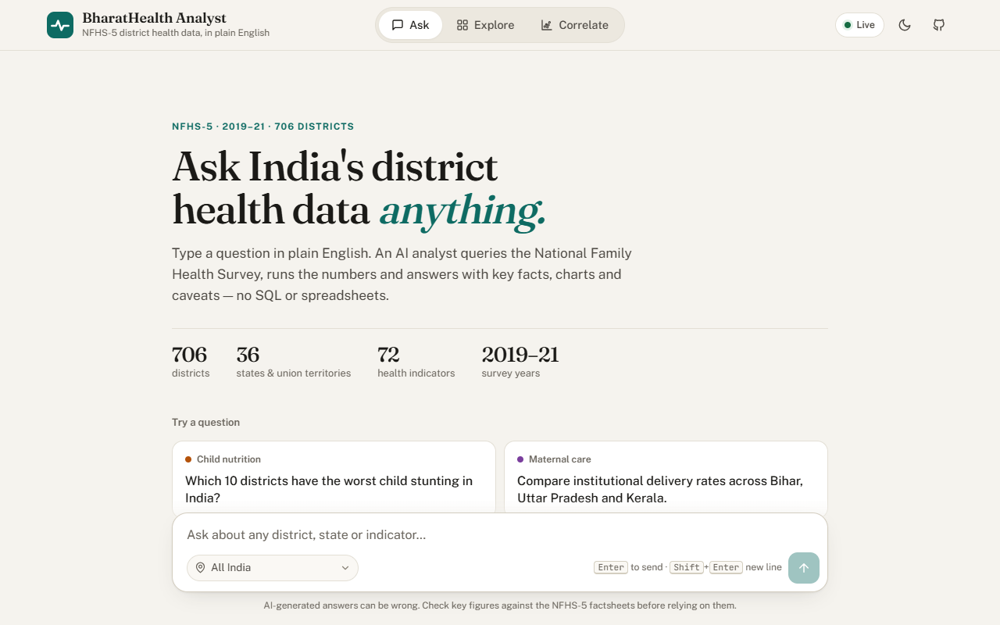
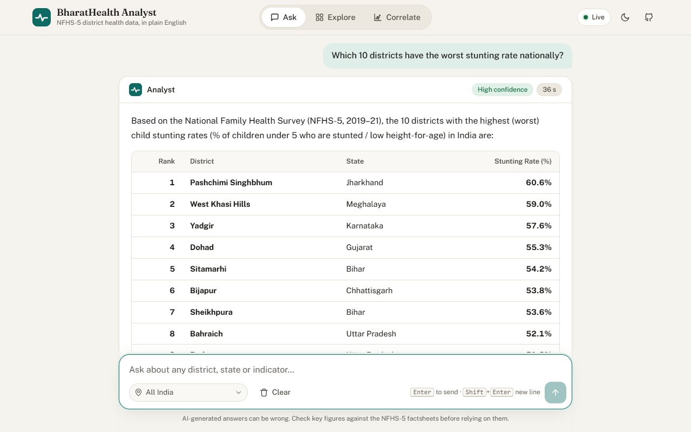
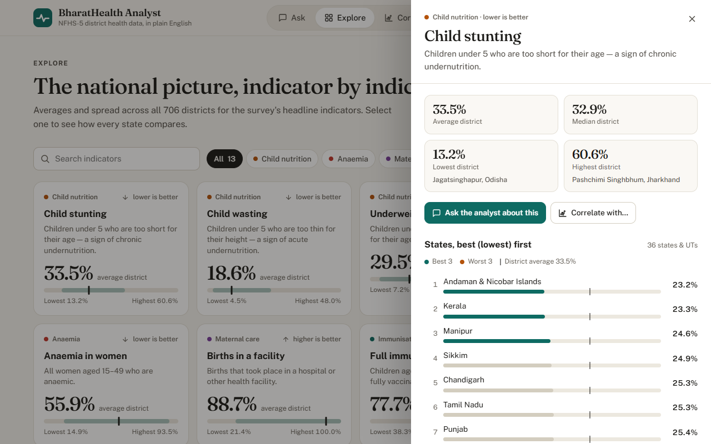
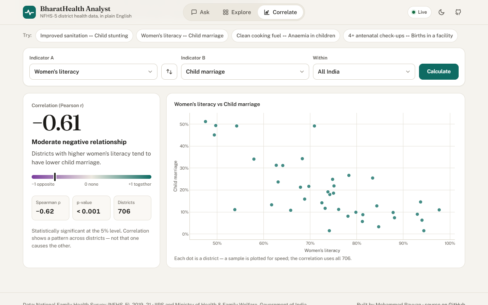
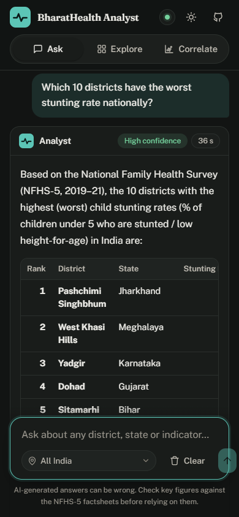

# BharatHealth Analyst

**Ask India's district health data anything.** A natural-language AI analyst over the NFHS-5 survey (2019–21): 706 districts, 36 states and union territories, 72 health indicators — queryable in plain English, with grounded answers, charts, key facts and caveats.

### [Try it live → rayyan-mohammed.github.io/aarogya-lens](https://rayyan-mohammed.github.io/aarogya-lens/)

[](https://github.com/Rayyan-mohammed/aarogya-lens/actions/workflows/tests.yml)
[](https://rayyan-mohammed.github.io/aarogya-lens/)
[](tests/test_api.py)
[](requirements.txt)
[](backend/api/main.py)
[](LICENSE)



> **Status: working prototype, in progress since 2026-06-02 (~20 weeks).** The data pipeline, vector store, agent, API, web app and the full 200-question accuracy benchmark are all built, tested and running — benchmark scores **EA 71.1%, AF 82.0%, HR 5.0%, RCQ 64.7%** overall. The live Q&A backend runs on the author's own machine behind a Cloudflare Tunnel, so it is sometimes offline; the site says so when it is, and its Explore tab keeps working regardless. See [Results](#results) for exactly what is and isn't proven.

---

## What you can do on the site

| | |
|---|---|
| **Ask** — type a question such as *"Which 10 districts have the worst child stunting?"* or *"Compare institutional delivery across Bihar, Uttar Pradesh and Kerala"*. The agent picks its own tools, queries all 706 districts and answers with formatted tables, a key-facts list, a confidence badge, a chart and the survey's data limitations. Optionally scope a question to one state. Typical answers take 30–90 seconds. |  |
| **Explore** — the national picture for 13 headline indicators: average district, lowest and highest district (by name), and whether higher or lower is better. Select one to rank all 36 states against the national average. This data ships inside the page, so it loads instantly and works even when the backend is offline. |  |
| **Correlate** — pick any two indicators (optionally within one state) to measure how closely they move together across districts: Pearson r and Spearman ρ, p-value, a plain-English reading such as *"districts with higher women's literacy tend to have lower child marriage"*, and a scatter plot. Strength labels use the same cut-offs as the backend, and every result carries the reminder that correlation is not causation. |  |

The site works on phones (all three views, full navigation) and follows your system's light or dark setting, with a manual toggle.

<p align="center"></p>

---

## Architecture

```mermaid
flowchart TB
    subgraph DATA["Data Layer"]
        CSV["NFHS-5 + NFHS-4 CSVs<br/>(dataset/)"]
        PIPE["pipeline.py<br/>cleaning + schema gen"]
        PARQUET[("706 districts x 448 cols<br/>parquet + schema.json")]
        CHROMA[("ChromaDB<br/>706 district embeddings")]
        CSV --> PIPE --> PARQUET --> CHROMA
    end

    subgraph AGENT["Agent Layer"]
        REACT["LangGraph ReAct Agent"]
        TOOLS["7 tools: semantic_search, pandas_query,<br/>sql_query, chart_generator, insight_writer,<br/>trend_analyser, correlation_finder"]
        REACT --> TOOLS
    end

    subgraph API["API Layer"]
        FASTAPI["FastAPI<br/>11 endpoints"]
        MW["rate limiting +<br/>request logging"]
    end

    subgraph CLIENT["Client Layer (GitHub Pages)"]
        HTML["Main site: one self-contained<br/>index.html — Ask / Explore / Correlate"]
        SNAP["Explore data snapshot<br/>(baked into the page)"]
        NEXT["Next.js 14 at /next<br/>(earlier UI; reads API address from api.json)"]
    end

    subgraph OPS["Ops (this machine)"]
        WATCHDOG["Windows Scheduled Task<br/>watchdog.ps1, every 10 min"]
        TUNNEL["Cloudflare Tunnel<br/>(URL rotates on restart)"]
    end

    subgraph EVAL["Evaluation"]
        BENCH["eval_runner.py<br/>200-question benchmark"]
        LLM[("Gemini 3.6 Flash<br/>free tier, rotating keys")]
    end

    PARQUET --> TOOLS
    CHROMA --> TOOLS
    PARQUET -. build_frontend_snapshot.py .-> SNAP
    SNAP --> HTML
    FASTAPI --> REACT
    FASTAPI --> MW
    REACT --> LLM
    BENCH --> REACT
    HTML --> TUNNEL --> FASTAPI
    NEXT --> TUNNEL
    WATCHDOG -.keeps alive.-> TUNNEL
    WATCHDOG -.keeps alive.-> FASTAPI
    WATCHDOG -.redeploys new URL.-> HTML
    WATCHDOG -.publishes api.json.-> NEXT

    style CSV fill:#dbeafe,stroke:#3b82f6
    style PIPE fill:#dbeafe,stroke:#3b82f6
    style PARQUET fill:#dbeafe,stroke:#3b82f6
    style CHROMA fill:#dbeafe,stroke:#3b82f6
    style REACT fill:#ede9fe,stroke:#8b5cf6
    style TOOLS fill:#ede9fe,stroke:#8b5cf6
    style FASTAPI fill:#dcfce7,stroke:#22c55e
    style MW fill:#dcfce7,stroke:#22c55e
    style HTML fill:#fef9c3,stroke:#eab308
    style SNAP fill:#fef9c3,stroke:#eab308
    style NEXT fill:#f3f4f6,stroke:#9ca3af
    style WATCHDOG fill:#fee2e2,stroke:#ef4444
    style TUNNEL fill:#fee2e2,stroke:#ef4444
    style BENCH fill:#ffedd5,stroke:#f97316
    style LLM fill:#ffedd5,stroke:#f97316
```

The site and the evaluation harness converge on a single FastAPI process running on one physical machine, reachable only through a Cloudflare Tunnel that a Windows Scheduled Task checks every 10 minutes. There is no independent cloud backend — the cheapest possible deployment, and the biggest single point of failure (see [Honest limitations](#honest-limitations)). The page is designed around that: it shows a live/offline indicator, explains failures in plain language, and keeps Explore fully usable from data bundled into the page.

---

## The problem

India's NFHS-5 survey publishes district-level health factsheets for over 700 districts across 36 states and union territories — but as raw CSV files and hundred-page-per-state PDF reports. Answering something as simple as "which districts have the worst child anaemia" means manually finding the right column and sorting every district by hand, and a trend question ("which districts improved most since 2015-16") means separately pulling and aligning an entirely different NFHS-4 dataset. There's no query interface between "I have a health-policy question" and "I have the raw survey files."

---

## How it works

| Layer / Component | What it does |
|---|---|
| **Data pipeline** (`backend/data/pipeline.py`) | Cleans the raw NFHS-5 factsheet CSV into 706 districts and generates `schema.json`, verified byte-for-byte in sync with the data. |
| **NFHS-4 trend merge** (`backend/data/nfhs4_integration.py`) | Merges real 2015-16 state-level NFHS-4 values for 62 indicators as a trend baseline, fallback-fills 2,286 missing NFHS-5 cells, and flags every imputed value with `_is_imputed`. The result is 448 columns: 72 NFHS-5 indicators, 341 NFHS-4 trend columns, 29 derived columns (ranks, percentiles, scores) and 6 identifier/sample columns. |
| **Vector store** (`backend/vector_store/`) | Embeds all 706 district summaries into ChromaDB with `all-MiniLM-L6-v2` — local, no API key required. |
| **Agent** (`backend/agent/agent.py`) | A LangGraph ReAct agent that plans and calls 7 tools (semantic search, pandas/SQL query, chart generation, insight writing, trend analysis, correlation). Runs on Gemini 3.6 Flash, rotating across several free-tier keys when one hits its daily quota. |
| **Sandboxed execution** (`backend/agent/tools/tools.py`) | `pandas_query` runs LLM-generated pandas code inside a restricted `exec()` with a whitelisted globals dict and a forbidden-token filter (blocks `import`, `open(`, `__`, `os.`, `sys.`, `subprocess`) — a custom sandbox, not the `RestrictedPython` library. |
| **API** (`backend/api/main.py`) | FastAPI, 11 endpoints, with request logging and a rate limiter (10 requests/minute per visitor; `/health` and chart files exempt). |
| **Web app** (`frontend/index.html`) | One self-contained HTML file, no build step — it has to be, because the watchdog deploys it by rewriting a single `const API_BASE = '…'` line and copying the file to the `gh-pages` branch. Renders the agent's markdown (tables, headings, lists) safely, with every string HTML-escaped before any tag is added. Draws the agent's charts itself from the figure JSON that `chart_generator` saves, so they follow the site's light/dark theme. Loads the charting library (plotly.js 3.5, the same version the backend writes) only when a chart is needed. |
| **Explore snapshot** (`scripts/build_frontend_snapshot.py`) | Bakes national and state-level figures for 13 indicators (~14 KB) into the page, so Explore needs zero API calls. NFHS-5 is a fixed survey, so the numbers never go stale; re-run the script only if the processed dataset changes. |
| **Evaluation harness** (`backend/evaluation/eval_runner.py`) | Runs a 200-question benchmark with programmatically computed ground truth and 5 metrics (EA, AF, HR, RCQ, latency), checkpointing after every question. `--query-type` re-runs a single category. |
| **Ops** (`scripts/watchdog.ps1`) | A Windows Scheduled Task, every 10 minutes and on battery too, running hidden with no console window: restarts the backend and tunnel if down, writes the new tunnel URL into the site and into `api.json` (which the `/next` build reads at runtime), commits it, and pushes straight to `gh-pages`. Also resumes an unfinished benchmark run. |

---

## Results

### 1. Data pipeline is complete and internally consistent

| Check | Result |
|---|---|
| District coverage | 706 districts × 448 columns (72 NFHS-5 indicators + NFHS-4 trend, derived and identifier columns) |
| NFHS-4 trend columns | 62 indicators merged, matching `schema.json` exactly (448/448 columns, zero drift) |
| Imputed cells | 2,286 missing NFHS-5 values fallback-filled, each flagged `_is_imputed` |
| DVC reproducibility | `dvc repro` — every regenerated output hashed **byte-for-byte identical** to what was already on disk; `dvc status` clean |

> **Honest scope:** the NFHS-4 trend baseline is state-level, not district-level, because that's what the source file (`NFHS-4_NFHS3_Factsheet-All_India_Indicators_R1.csv`) actually contains. Trend answers are disclosed to the user as state-baseline comparisons, not true district-to-district deltas.

### 2. Automated test suite passes, with measured (not estimated) coverage

Measured locally on 2026-10-21:

| Module | Coverage |
|---|---|
| `backend/api/main.py` (11 endpoints) | 93% |
| `backend/agent/tools/tools.py` (7 tools) | 74% |
| `backend/evaluation/eval_runner.py` | 42% |
| **Total, 65 tests** | **all passing, 63% combined** |

> **Honest scope:** the untested part of `eval_runner.py` is almost entirely the live LLM-calling loop (key rotation, quota-exhaustion stops, resume logic) — it can only be exercised by an actual model run, not a unit test with a mocked response. It grew in September with the multi-key and single-category features, which is why its coverage fell from 47% to 42%. The scoring functions themselves are covered by `tests/test_eval_scoring.py`.

### 3. Full 200-question benchmark complete, with one category re-validated after a prompt fix

The 200-question benchmark (`benchmark_questions.json`: 59 factual, 52 ranking/aggregation, 30 state comparison, 38 trend, 21 correlation) ran to completion against Gemini `gemini-3.6-flash`, after two earlier disqualified attempts:

| Attempt | Date | Model | Outcome |
|---|---|---|---|
| Full run #1 | 2026-08-17 | Groq `llama-3.3-70b-versatile` | Completed all 200, but Groq deprecated the model mid-run — result file kept as `eval_results.groq_contaminated_aug17.json` and **not used**, since an unknown fraction of answers came from a model that no longer existed by the time the run finished. |
| Full run #2 | 2026-08-19 | Gemini `gemini-3.6-flash` | Blocked by Gemini's free tier: 20 requests/day on a single key. Fixed by rotating across multiple keys/projects, each with an independent daily quota. |
| Full run #3 | 2026-09-16 | Gemini `gemini-3.6-flash`, multi-key rotation | **Completed, 200/200.** Numbers below. |

**Overall (200 questions, rescored 2026-10-11 with every scoring-harness fix found to date):**

| Metric | Score |
|---|---|
| EA (exact answer accuracy) | 71.1% |
| AF (answer faithfulness) | 82.0% |
| HR (hallucination rate) | 5.0% |
| RCQ (reasoning chain quality) | 64.7% |
| Mean latency | 120 s/question |

**By category:**

| Category | n | EA | AF | HR | RCQ |
|---|---|---|---|---|---|
| factual_lookup | 59 | 100% | 76.3% | 15.3% | 60.7% |
| aggregation_ranking | 52 | 66.7% | 86.5% | 0% | 74.0% |
| correlation | 21 | 81.0% | 100% | 4.8% | 82.6% |
| state_comparison | 30 | 35.8% | 90.0% | 0% | 78.7% |
| trend_analysis | 38 | 54.4%† | 68.4% | 0% | 37.2%† |

† **trend_analysis has since been re-validated against a fixed system prompt** — EA 54.4% → **84.5%**, RCQ 37.2% → **89.2%** on a clean, full 38-question re-run (`backend/evaluation/eval_results.subset_trend_analysis.json`). The other four categories above still reflect the prompt as it stood before that fix; whether the same gain generalizes to them is not yet confirmed.

**What the low `trend_analysis` RCQ turned out to be:** not a model failure, but a routing gap in the system prompt. The agent has a purpose-built `trend_analyser` tool that returns mean/median/min/max plus best/worst districts in a single call, but the prompt only routed to it for explicit "trend" or "since NFHS-4" wording. The actual benchmark questions in that category never use that phrasing — e.g. *"what is the distribution of X across all districts, which states perform best and worst"* — so the agent fell back to reconstructing the same numbers with 2-4 rounds of hand-written `pandas_query` code instead, and called `insight_writer` on almost every question regardless of need. Fixed by routing on question shape instead of keyword and making `chart_generator`/`insight_writer` usage explicit rules rather than left to judgment; verified live before (`trend_analyser` used 2/38 times) and after (37/38) the fix.

**Four scoring-harness bugs were also found and fixed**, independent of model behavior, that were making the agent look worse than it actually was:
- The answer-faithfulness verifier had no handling at all for one entire claim shape ("State A: X%, State B: Y%"), so every comparison-style answer scored AF=0 regardless of accuracy.
- The hallucination checker flagged generic words ("National", "The", "Best") immediately preceding the word "district" as fabricated place names — confirmed via zero overlap with any of the 698 real district names in the dataset.
- The numeric extractor had no negative-sign handling, so ground truth like `"Correlation: -0.083"` was read as `+0.083`.
- The ranking scorer overwrote a district's rank position on every repeated mention, so a district named early and referenced again later (common in summary paragraphs) scored as if it had moved — one question listed the ground-truth districts in the exact right order and still scored 0 before the fix.

> **Honest scope:** EA/AF/HR above are rescored with every fix found to date; RCQ and the underlying answers for 4 of 5 categories still reflect the prompt before the routing fix. `AF` is known to still undercount markdown-bullet-formatted answers (`**Label:** value%`) that don't match any of the claim-extraction regex patterns — most visible in `trend_analysis`'s still-low 68.4% AF despite high EA. See [docs/COMPLETION_SUMMARY.md](docs/COMPLETION_SUMMARY.md) for the full bug list and dates.

### 4. The web app is deployed, tested and built for an unreliable backend

The main site was redesigned on 2026-10-21. Before that, the agent's answers rendered as raw markdown (tables appeared as `| :--- |` pipe text, followed by a raw JSON block), the whole sidebar — and with it Explore, Correlate and the state filter — was hidden on phones, and the page was unusable whenever the tunnel was down. The redesign was checked in a real browser (Playwright/Chromium) at desktop and phone sizes in light and dark mode, against a real agent answer, with no console errors or horizontal overflow, including each failure path: backend offline, Cloudflare's 5xx page when the tunnel is up but the backend isn't, the API's rate limit, an exhausted AI quota, the 5-minute timeout, and a user pressing Stop.

The same day's follow-up fixed three more things, each verified on the live site with a real question:
- **The agent's charts now match the site.** `chart_generator` also saves each figure as JSON, and the site draws it in its own colours, fonts and light/dark theme, with readable axis names ("Child stunting (%)" rather than `stunting_pct`). Charts made before that change still show as before. This also surfaced a long-standing bug: every scatter chart had been failing, because `trendline="ols"` needs `statsmodels`, which was never a dependency — the trend line is now fitted with numpy.
- **`/next` works again.** It had its API address baked in at build time, so it went dead on every tunnel rotation. It now reads the current address from `api.json` at runtime, and the watchdog republishes that file on each rotation. Fixing it also revealed that `frontend-nextjs/lib/api.ts` had never been committed (a Python `lib/` rule in `.gitignore` was hiding it), so the app couldn't be built from a fresh clone.
- **The watchdog actually self-heals now.** It was set not to start on battery, but the bigger problem was that every time it restarted the tunnel, the new `cloudflared` process inherited the watchdog's open log file and kept it locked, so every later run failed on its first line until the tunnel died. On top of that, runs in a visible console window could be closed or Ctrl+C'd mid-restart. It now runs on battery, catches up straight after sleep, runs hidden, launches `cloudflared` without inheriting handles, and only logs "redeployed" when the push really succeeded.

| Site | URL | Status |
|---|---|---|
| Main site (`frontend/index.html`) | [rayyan-mohammed.github.io/aarogya-lens](https://rayyan-mohammed.github.io/aarogya-lens/) | Live; redeployed automatically whenever the tunnel URL rotates |
| Next.js 14 build (`frontend-nextjs/`) | [rayyan-mohammed.github.io/aarogya-lens/next](https://rayyan-mohammed.github.io/aarogya-lens/next/) | Live; the earlier UI, rebuilt 2026-10-21 to read the API address at runtime |

> **Honest scope:** the site is static; the live Q&A and Correlate need the tunneled backend on the author's machine. Render, Hugging Face Spaces and Vercel were each tried for the API and each hit a real platform wall (billing requirement, billing requirement, and Vercel's 250 MB serverless limit — `pandas` + `numpy` + `scipy` + `plotly` alone are ~267 MB) — not a config mistake. Details in [docs/DEPLOYMENT_GUIDE.md](docs/DEPLOYMENT_GUIDE.md).

---

## Honest limitations

- **The live backend is one laptop.** Q&A and Correlate exist only while this Windows machine is on, awake and online. When it is, the watchdog brings the backend and tunnel back within about 10 minutes of any failure (on battery too); while it's off or asleep, the live features are simply down. Explore works either way.
- **`/next` is the earlier UI.** It works, but it predates the redesign (no rendered tables, no offline Explore, no dark mode). The main site is the maintained one.
- **Benchmark RCQ is a confirmed floor, not a final number.** Only 1 of 5 categories (`trend_analysis`, 38/200) has been re-run against the prompt fix that raised its RCQ from 37.2% to 89.2%. The other four still reflect the prompt before that fix — the true current RCQ is likely higher than 64.7% but unconfirmed at full scale.
- **AF still undercounts one answer format.** The claim-extraction regex used for answer faithfulness doesn't match markdown-bullet-style claims (`**Label:** value%`), which is common in longer answers. A real gap, not yet fixed.
- **Free-tier AI quota.** Every live answer spends shared free-tier Gemini quota, which resets daily; heavy use can exhaust it, and the site then says so rather than failing silently. Of five configured providers (Groq, Gemini, OpenRouter, Grok, DeepSeek), none is a paid tier — Claude and GPT-4o code paths in `agent.py` exist but have never been run against a real key.
- **CI runs against fixture data, not the DVC pipeline.** `.github/workflows/tests.yml` rebuilds the processed dataset from two small CSV copies checked into `.github/ci-fixtures/` because the configured DVC remote is a local-only folder on the author's machine — `dvc pull` can't reach it from a GitHub Actions runner. See [.github/ci-fixtures/README.md](.github/ci-fixtures/README.md).
- **Trend data is a state-level approximation.** NFHS-4 comparisons are disclosed as state-baseline, not true district-level, because the source data is state-level.
- **The benchmark question generator isn't fully reproducible.** 119 of the 200 questions come from a seeded script; the remaining 81 come from a second script using unseeded `random.choice()`, so the full set can't be regenerated byte-for-byte — it's tracked as data, not pipeline output.

---

## Repository structure

```
aarogya-lens/
├── backend/
│   ├── agent/agent.py              # LangGraph ReAct agent + system prompt
│   ├── agent/tools/tools.py        # 7 tools, incl. the sandboxed pandas_query
│   ├── api/main.py                 # FastAPI app, 11 endpoints
│   ├── api/middleware.py           # rate limiting + request logging
│   ├── data/pipeline.py            # NFHS-5 cleaning + schema generation
│   ├── data/nfhs4_integration.py   # NFHS-4 trend merge + fallback fill
│   ├── data/*.parquet, schema.json # processed dataset (DVC-tracked)
│   ├── evaluation/eval_runner.py   # 200-question benchmark runner, 5 metrics
│   ├── evaluation/benchmark_questions.json
│   └── vector_store/               # ChromaDB build + index
├── frontend/index.html             # the live site — one self-contained file
├── frontend-nextjs/                # Next.js 14 rewrite (older, deployed at /next)
├── tests/                          # 65 pytest tests
├── scripts/
│   ├── watchdog.ps1                # keeps backend + tunnel alive, redeploys the site
│   ├── run_watchdog.vbs            # what the scheduled task runs (hidden, no console)
│   ├── run_watchdog.bat            # run the watchdog by hand
│   ├── register_watchdog.ps1       # one-time scheduled task setup
│   ├── build_frontend_snapshot.py  # bakes Explore's data into frontend/index.html
│   └── …                           # manual demo/smoke scripts (not pytest)
├── docs/                           # blueprint, technical report, deployment guide, screenshots
├── dataset/                        # raw source CSVs/PDFs (DVC-tracked)
├── dvc.yaml, .dvc/                 # data versioning, verified with dvc repro
├── Dockerfile, docker-compose.yml  # verified locally
└── render.yaml                     # kept for reference; Render hit a billing wall
```

---

## Quick start

Zero external dependencies, zero API keys, just the pre-built data:

```bash
pip install -r requirements.txt

# run the full test suite — no LLM key needed, nothing leaves your machine
pytest
```

That exercises the data pipeline, all 7 agent tools, the scoring functions and every API endpoint against fixtures — the fastest way to see the core system actually work.

---

## Run it locally

```bash
# backend — needs GEMINI_API_KEY in .env (optionally GEMINI_API_KEY_2, _3, … for key rotation)
python -m uvicorn backend.api.main:app --reload --port 8000

# site, in a second terminal — open http://localhost:3000
python -m http.server 3000 --directory frontend
```

A copy of the site served from `localhost` automatically talks to the backend on `http://localhost:8000`. To point any copy of the page at a different backend, add `?api=<url>` to its address.

```bash
# after changing the processed dataset, refresh Explore's bundled figures
python scripts/build_frontend_snapshot.py
```

```bash
# data pipeline, from raw CSVs
dvc repro                          # rebuilds parquet, schema.json, vector store, benchmark set
dvc status                         # should report clean
```

```bash
# evaluation — small sample, not the full 200-question run
python -m backend.evaluation.eval_runner --model gemini --n 5

# or re-check one category only (e.g. after a prompt change) instead of all 200
python -m backend.evaluation.eval_runner --model gemini --query-type trend_analysis
```

```bash
# docker — verified to build and run locally, matches production Dockerfile
docker compose up --build
curl http://localhost:8000/health
```

---

## Operational notes

**How the live site stays up.** A Windows Scheduled Task (`BharatHealthWatchdog`, set up by `scripts/register_watchdog.ps1`) runs `scripts/run_watchdog.vbs` every 10 minutes, on battery too, with no console window. Each run takes 5–35 seconds: if the backend or tunnel is down it restarts them, writes the new tunnel URL into `frontend/index.html` and `api.json`, commits and pushes that to `main`, and pushes the page to the `gh-pages` branch, which GitHub Pages serves 10–30 seconds later. It logs to `scripts/watchdog.log`, with full raw output of the last run in `scripts/.raw_stdout`. To bring the site back immediately instead of waiting for the next run:

```powershell
scripts\run_watchdog.bat
```

**Deploying a change to the site.** Commit `frontend/index.html` to `main`; the watchdog ships it on the next tunnel rotation. To ship it right away, copy it to `gh-pages` through a worktree (the watchdog syncs its local `gh-pages` with GitHub before each deploy, so this can't block it):

```bash
git fetch origin gh-pages && git branch -f gh-pages origin/gh-pages
git worktree add ../ghp gh-pages
cp frontend/index.html ../ghp/index.html
(cd ../ghp && git commit -am "deploy site" && git push origin gh-pages)
git worktree remove ../ghp
```

**Cost and quota.** There's no cloud billing risk — everything runs on free-tier API quotas and a local machine. The real operational risk is the opposite: a background process silently burning through a free-tier daily quota. To stop everything cleanly:

```powershell
# stop the watchdog scheduled task (backend, tunnel, and benchmark stop restarting)
schtasks /end /tn BharatHealthWatchdog
schtasks /delete /tn BharatHealthWatchdog /f

# stop the running backend and tunnel processes
Get-Process uvicorn, cloudflared -ErrorAction SilentlyContinue | Stop-Process
```

The watchdog exists because early benchmark runs got silently killed by machine sleep and had to be restarted from question 1 more than once — it trades "runs unattended" for "you must remember it's running."

---

## Roadmap

| Phase | Data pipeline | Agent + tools | API | Web app | Evaluation | Deployment |
|---|---|---|---|---|---|---|
| Weeks 1-4 (Jun 2026) | ✅ NFHS-5 clean + schema | ✅ 7 tools built | — | — | — | — |
| Weeks 5-8 (Jul 2026) | ✅ NFHS-4 trend merge | ✅ ReAct agent wired up | ✅ 11 endpoints + middleware | ✅ HTML/JS UI | ✅ 200-Q set + 5 metrics | ✅ Docker local |
| Weeks 9-11 (Aug 2026) | ✅ DVC pipeline verified | ✅ sandboxed pandas_query | ✅ 93% test coverage, ✅ CI on every push | ✅ Next.js rewrite deployed | ⏳ blocked on free-tier quota (2 attempts) | ✅ GitHub Pages, tunnel + watchdog |
| Weeks 12-19 (Sep-Oct 2026) | — | ✅ trend_analyser/chart_generator routing fix (RCQ 37.2%→89.2% on re-validated category) | — | — | ✅ 200/200 run complete, 4 scoring bugs fixed, 1/5 categories re-validated | — |
| Week 20 (Oct 2026) | ✅ Explore snapshot baked into the site | ✅ Scatter charts fixed (no statsmodels needed) | — | ✅ Main site redesigned: rendered answers, mobile, dark mode, offline Explore, themed agent charts; `/next` working again | — | ✅ Watchdog self-heals: runs hidden and on battery, no more file-lock lockouts |
| Next | Real DVC remote (CI still uses fixture CSVs) | Claude/GPT-4o path, untested; re-validate routing fix on remaining 4 categories | — | — | Full fresh 200-Q run once a paid API key removes the free-tier quota ceiling | Persistent (non-tunnel) API host, e.g. an always-free cloud VM running the existing Docker image |

---

## Author

- **Mohammed Rayyan** ([rayyan1652@gmail.com](mailto:rayyan1652@gmail.com)) — sole author and owner of the entire system: data pipeline, agent and tools, API, web app, evaluation harness, and deployment/ops. B.Tech CSE (Data Science), NMIMS University, Hyderabad.

Data: National Family Health Survey (NFHS-5), 2019–21, International Institute for Population Sciences (IIPS) and the Ministry of Health and Family Welfare, Government of India.

---

## Documentation index

- [docs/COMPLETION_SUMMARY.md](docs/COMPLETION_SUMMARY.md) — detailed status log and full bug history, with dates
- [docs/BharatHealth_Project_Blueprint.md](docs/BharatHealth_Project_Blueprint.md) — original project scope and design intent
- [docs/TECHNICAL_REPORT.md](docs/TECHNICAL_REPORT.md) — architecture and implementation write-up
- [docs/DEPLOYMENT_GUIDE.md](docs/DEPLOYMENT_GUIDE.md) — what was tried (Render, HF Spaces, Vercel) and why each didn't stick
- [docs/SUBMISSION_PACKAGE.md](docs/SUBMISSION_PACKAGE.md) — coursework/submission-facing summary
- [scripts/README.md](scripts/README.md) — what each manual demo/smoke-test script does
- [.github/ci-fixtures/README.md](.github/ci-fixtures/README.md) — why CI rebuilds data from fixture CSVs instead of `dvc pull`
- [LICENSE](LICENSE) — MIT
